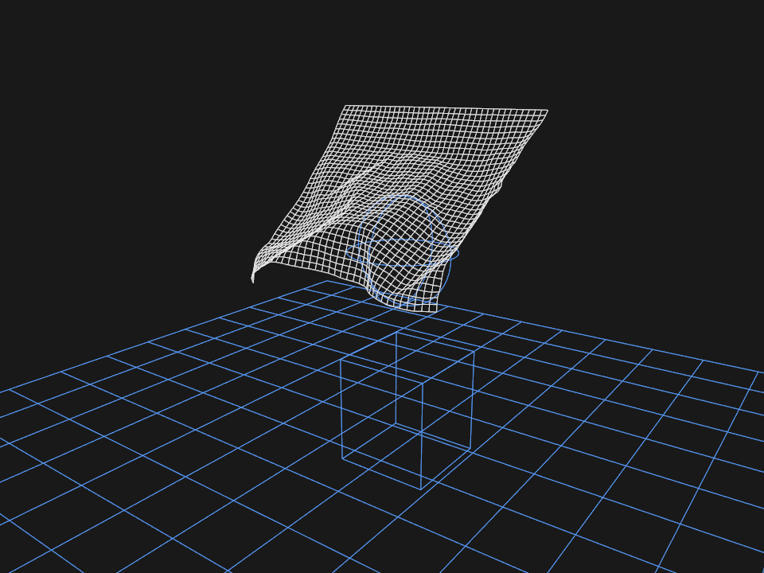

# Cloth Simulation

<p align="center">
  
</p>

<p align="center">
  
  
  
</p>
<p align="center"><em>Left to right: draped over the colliders, pushed by the sphere, torn apart.</em></p>

## Controls

| Key | Action |
| --- | --- |
| Space | Release the pinned edge so the cloth falls |
| T (hold) | Pull the pinned edge apart to tear the cloth |
| W / A / S / D | Move the sphere |
| Q / E | Move the sphere down / up |
| R | Reset |
| Esc | Quit |

## Dependencies

- CMake 3.16+
- A C++20 compiler
- GLFW 3
- OpenGL (system-provided)

GLM and GLAD are vendored in `include/` — GLM as a git submodule, so clone recursively.

### macOS

```bash
brew install cmake glfw
```

### Linux (Debian/Ubuntu)

```bash
sudo apt install cmake build-essential libglfw3-dev
```

## Build & run

```bash
git clone --recurse-submodules git@github.com:Jaewon0407/Cloth-Simulation.git
cd Cloth-Simulation
cmake -S . -B build
cmake --build build
cd build && ./ClothSimulation
```

If you already cloned without `--recurse-submodules`:

```bash
git submodule update --init --recursive
```

The build copies `shaders/` next to the executable, so run the binary from the
directory that contains it (`build/`).

## Benchmark

`ClothBenchmark` runs the physics without a window and compares one thread against all cores:

```bash
cd build && ./ClothBenchmark [frames] [threads]
```
